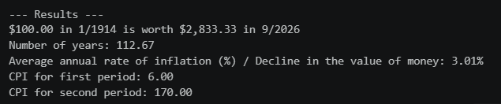

# Canadian Inflation Calculator

## Introduction and Project Scope
A Python inflation calculator built with pandas, NumPy and Matplotlib. It uses the Bank of Canada's monthly Consumer Price Index (CPI) data from 1914 to the present to show how the purchasing power of a dollar has changed between any two months. It is modelled on the Bank of Canada Inflation Calculator: https://www.bankofcanada.ca/rates/related/inflation-calculator/

Inflation is the rise in the cost of a fixed basket of consumer purchases (food, shelter, furniture, clothing, transportation and recreation) over time. This project answers questions such as: what would a basket that cost $100 in 1995 cost today?

The project does three things:

    1. Loads the Bank of Canada CPI data (2002 = 100) into a pandas DataFrame.
    2. Plots the CPI together with its annual percentage change.
    3. Prompts the user for a price and two dates, then reports the inflation-adjusted price, the percent change, the number of years between the dates and the average annual rate of inflation.

## File Breakdown

### Files in this Repository: 
**inflation_calculator.ipynb**: Jupyter notebook containing all of the code, including the data import, CPI chart, the Inflation_Calculator class, input validation and the results output.
**STATIC_INFLATIONCALC.csv**: Monthly Canadian CPI data (1914 to present) downloaded from the Bank of Canada. The first 8 lines are metadata, so the notebook reads the file with skiprows=8.
**Cpi_chart.png**: The CPI chart produced by the notebook (300 dpi).
**Output Example.png**: An example output that input the first date as 01/1914 and last date as 09/2026 with $100 as first price.
 **README.md**: This write-up.

## How the Code Was Created

The notebook is split into cells that are run in order:

**Imports**: pandas handles the data, matplotlib draws the chart and numpy supports the array calculations.
**Loading the data**: pd.read_csv("STATIC_INFLATIONCALC.csv", skiprows=8) skips the metadata lines at the top of the file. The date column is converted to a datetime and set as the index, so any month can be looked up by its year and month.
**The Inflation_Calculator class**: The class stores the user's price and two dates. Its methods each do one job:
     - get_cpi(year, month) looks up the CPI for a given month.
     - CPI_Calculation() returns the CPI for the first and second period.
     - Inflation_Adjusted_Price_Calculation() converts the price from the first period to the second.
     - Dollar_Change_Calculation() and Percentage_Change_Calculation() measure how much the price changed.
     - Number_of_years_calculation() returns the time between the two dates in years.
     - Average_Annual_Inflation_Calculation() returns the average annual rate of inflation.
**The CPI chart**: The CPI is plotted on the left axis and the 12-month percentage change (pct_change(12) * 100) on a second, right-hand axis. The figure is saved as cpi_chart.png.
 **User input**: Each input is checked in a while True loop. Prices must be a number above 0, years must fall inside the dataset, months must be 1 to 12, and the month must exist in the data for the first and last year. Invalid entries show a message and the question is asked again.
**Results**: The calculator object is created from the inputs and the results are printed, rounded to the nearest penny with dollar signs and a currency identifier.

## Key Formulas

In these formulas, CPI1 and CPI2 are the CPI in the first and second period, and Cost1 and Cost2 are the price in each period.

**Inflation-adjusted price**: Cost2 = Cost1 x (CPI2 / CPI1)
**Dollar change**: Cost2 - Cost1
**Percent change**: ((Cost2 - Cost1) / Cost1) x 100
**Number of years**: (end_year - start_year) + (end_month - start_month) / 12
**Average annual rate of inflation**: ((CPI2 / CPI1) ^ (1 / years) - 1) x 100

The cost and percent change formulas are the ones published on the Bank of Canada calculator page. The average annual rate is the compound annual growth rate of the CPI.

## CPI Graph Of Data 

Below is a graph of the CPI over time: 

### Commentary on the CPI
**Long-run trend** : The CPI has climbed from a single-digit level in 1914 to well above 100 today, so a basket of goods now costs many times what it did a century ago.
**World War I (1914 to 1920)**: Wartime spending and supply shortages pushed annual inflation into double digits, the first big spike on the red line.
**World War II**: Price controls kept inflation relatively low despite the large increase in government spending.
**The 1970s and early 1980s**: Oil shocks and rising wages led to high, persistent inflation, with annual rates in the double digits at the peak. This is the steepest sustained rise in the CPI line.
**Inflation targeting (1991 onward)**: After the Bank of Canada adopted a 2% inflation target, the red line becomes much flatter and inflation stays close to that target for about three decades.
**2021 to 2023**: Post-pandemic supply disruptions and strong demand drove inflation to its highest level in roughly 40 years, peaking above 8% in 2022 before easing.

## Sample Output 

Below is a sample output of the project when inputed 01/1914 as the first date, $100 as the price at this first date, and 09/2026 as the second date: 

